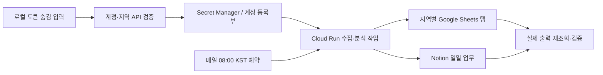

# SNS Comment Pipeline

액세스 토큰으로 접근 가능한 Instagram 계정을 검증하고, 지역별 댓글을 수집·분석해
Google Sheets와 Notion 일일 업무에 반영하는 MadeOne 내부 자동화다.

별도 관리 웹사이트는 사용하지 않는다. 토큰 변경은 포함된 macOS 실행 파일에서
진행하고, 실제 수집·분석·갱신은 기존 Google Cloud 작업에서 수행한다.



## 토큰 변경

Python 3.12 이상과 Google Cloud CLI가 설치된 macOS에서 저장소를 내려받는다.
회사 계정에 기존 클라우드 작업·상태 저장소·Secret Manager 접근 권한이 필요하다.
개인 서비스 계정 키 파일을 내려받거나 저장소에 넣지 않는다.

```sh
git clone git@github.com:madeone1/sns-comment-pipeline.git
cd sns-comment-pipeline
gcloud auth login syan@madeone.kr
./change-access-token.command
```

Finder에서 `change-access-token.command`를 열어도 된다. 토큰은 표시되지 않는
입력란에 붙여 넣는다. 검증된 새 계정에만 지역 표시명을 한 번 지정한다.
저장 직후 클라우드 갱신 작업을 시작하며, 이후 매일 08시 작업에도 계속 반영된다.
이미 시작한 클라우드 작업은 로컬 창을 닫아도 계속된다.

```sh
./change-access-token.command --check   # 현재 토큰으로 실제 API 접근 검증, 변경 없음
./change-access-token.command --status  # 시트·노션까지 반영됐는지 조회
```

A·B·C에서 A·D·E로 바뀌면 A의 이력을 유지하고, B·C의 시트 탭은 숨김 보관한다.
D·E는 계정 ID에 따라 새 탭을 만들며, Notion 현재 요약은 A·D·E를 사용한다.
검증 실패·미등록 지역·수집 미확인은 정상 0건으로 처리하지 않는다.
자세한 동작은 [TOKEN-CONNECTIONS.md](TOKEN-CONNECTIONS.md)를 따른다.

## 보고 기준

매 분석·갱신 시 채택된 Notion 참조 문서를 다시 읽고 버전·수정 시각·내용 지문을
확인한다. Notion의 `SNS Comments`는 일반 제목이며, 아래 지역별 항목은 토글이다.
사람이 작성한 시트 값과 기존 댓글 근거·제외 계정의 과거 보고를 보존한다.
[WORKFLOW.md](WORKFLOW.md), [DAILY_MERGE.md](DAILY_MERGE.md)에 상세 동작이 있다.

## 코드 구성

| 경로 | 용도 |
| --- | --- |
| `change-access-token.command` | 현재 운영용 토큰 변경 실행 파일 |
| `sns_comment/token_cli.py` | 숨김 입력, 검증, 클라우드 연결·작업 시작 |
| `sns_comment/token_connections.py` | 인증 버전별 계정 스냅샷, 지역 매핑, 출력 검증 |
| `sns_comment/connection_registry.py` | 계정 ID별 경로·지역·이력 |
| `sns_comment/cloud.py` | 수집·분석·시트·Notion 운영 작업 |
| `sns_comment/account_tabs.py` | 계정별 시트 탭과 과거 이력 보관 |
| `sns_comment/notion_mcp.py`, `regional_notion.py`, `guidance.py` | 최신 지침, 일반 제목·지역 토글, 보고 보존 |
| `sns_comment/webhook.py`, `webhook_worker.py` | Meta 댓글 웹훅 수신·후속 처리 |
| `Dockerfile`, `Dockerfile.webhook` | 수집기와 웹훅 수신기 컨테이너 |
| `scripts/token_connection_release.py` | 현재 수집기 준비·빌드·검증·배포 |
| `scripts/webhook_release.py`, `webhook_connect.py` | 웹훅 수신기 배포·연결 |
| `scripts/legacy/`, `docs/history/` | 과거 클라우드 배포·검증 코드와 기록 |
| `tests/` | 합성 API와 시트·Notion 모형을 이용한 자동 검증 |
| `config.json` | 현재 운영 설정의 기준 사본. 토큰값은 없음 |

기존 로컬 수집·진단·Notion 초기 연결용 `.command` 파일도 포함한다.
`connect-accounts.command`는 과거 로컬 Keychain 연결용이며, 현재 클라우드의
수집 대상을 바꾸려면 `change-access-token.command`를 사용한다.

## 개발·검증

수집기·로컬 실행 파일과 자동 테스트는 Python 표준 라이브러리를 사용한다.
웹훅 컨테이너만 Dockerfile에서 Gunicorn을 설치한다.

```sh
python3 -m unittest discover -s tests -q
python3 -m sns_comment.token_cli --help
python3 scripts/token_connection_release.py --help
```

GitHub Actions는 테스트만 실행한다. 클라우드 배포나 실제 토큰 변경을 수행하지
않는다. 운영 배포 절차와 인증 참조는 [CLOUD.md](CLOUD.md)에 있다.

## 저장 범위

이 저장소는 회사 비공개 소스 저장소다. 토큰 원문·OAuth 인증 파일·Keychain 값·
댓글 원본·SQLite DB·실행 로그·개인 검증 자료는 포함하지 않는다.
`config.json`에는 회사 리소스 ID와 Secret 참조 경로만 들어 있다.
실제 토큰은 Google Secret Manager, 원본·등록부·상태는 비공개 Cloud Storage에
계속 보관한다. 과거 호환 경로 `web/registry.json`은 웹사이트 실행과 무관하다.
