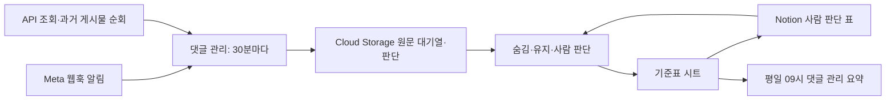

# Instagram Comment Pipeline

이 폴더는 원격 `main`의 Instagram 코드를 플랫폼별로 옮긴 것이다.
아래 명령과 파일 경로는 `instagram/` 폴더를 기준으로 한다.
저장소 루트에서 시작한다면 먼저 `cd instagram`을 실행한다.

Instagram 댓글을 30분마다 수집·분류하고, 규정집 v2.3에 따라 숨김 또는
사람 판단으로 처리하는 MadeOne 내부 자동화다. 평일 09시에는 Notion 일일 업무의
Develop 구역에 댓글 관리 요약을 게시한다.

2026-11-17부터 기존 08시 `sns-comments-daily` 수집·분석·SNS Comments 보고는
종료한다. 원본 시트의 전체 댓글 누적 갱신도 이 작업과 함께 종료하며 기존 원본,
검수 입력, 보고서는 보존한다. 관리용 기준표 시트와 09시 요약은 계속 갱신한다.
별도 관리 웹사이트는 사용하지 않는다.

2026-11-20부터 기존 `인스타 댓글 관리` 보고 안에 유튜브 요약과 별도 시트 링크도
함께 표시한다. 유튜브 집계·추가는 `youtube/`의 독립 보고 작업이 담당하며,
이 폴더의 인스타 보고 예약은 그대로 유지한다. 인스타 보고를 다시 작성할 때도
이미 추가된 유튜브 항목은 보존한다.



## 토큰 변경

Python 3.12 이상과 Google Cloud CLI가 설치된 컴퓨터에서 저장소를 내려받는다.
지금 로그인된 회사 Google 계정으로 실행한다.
Secret Manager 비밀 `sns-meta-token`, 상태 버킷, Cloud Run Job 실행 권한이 필요하다.
예: `josh@madeone.kr`. 개인 서비스 계정 키 파일을 내려받거나 저장소에 넣지 않는다.
맥과 Windows 모두 추가 패키지나 가상환경 없이, 설치한 Python 표준 기능만 사용한다.

### macOS

```sh
git clone git@github.com:madeone1/sns-comment-pipeline.git
cd sns-comment-pipeline/instagram
gcloud auth login
./change-access-token.command
```

Finder에서 `change-access-token.command`를 열어도 된다.

```sh
./change-access-token.command --check   # 현재 토큰으로 실제 API 접근 검증, 변경 없음
./change-access-token.command --status  # 시트·노션까지 반영됐는지 조회
```

### Windows

1. Python 3.12 이상을 설치한다. https://www.python.org/downloads/windows/
   설치 화면에서 **Add python.exe to PATH** 를 선택한다.
2. Google Cloud CLI를 설치한다. https://cloud.google.com/sdk/docs/install
3. 설치가 끝나면 **새로 연** 명령 프롬프트에서 회사 계정으로 로그인한다.

```bat
gcloud auth login josh@madeone.kr
```

4. 저장소의 `instagram` 폴더에 있는 `change-access-token.bat` 을 더블클릭한다.
   명령 프롬프트에서 확인만 하려면 아래를 실행한다. 토큰은 바꾸지 않는다.

```bat
change-access-token.bat --check
```

`change-access-token.ps1` 은 bat가 부르는 실행 파일이므로 직접 열지 않아도 된다.
Python이나 Google Cloud CLI가 없으면 설치 링크를 한글로 보여 주고 끝난다.
토큰 입력은 화면에 글자가 보이지 않는다. 결과는 Enter를 누를 때까지 창에 남는다.

실행하면 사용 중인 Google 계정을 먼저 보여 준다. 다른 계정을 쓰려면
`--account 이메일` 또는 환경변수 `SNS_GCLOUD_ACCOUNT`를 지정한다.
`config.json`의 `cloud.account`가 비어 있으면 활성 계정을 쓰고, 이메일이 있으면
그 주소를 기본값으로만 쓴다. 플래그와 환경변수가 설정보다 우선한다.
로그인이 없거나 권한이 없으면 토큰을 묻기 전에 멈추고 `gcloud auth login`으로
다시 로그인하라고 안내한다.

토큰은 표시되지 않는 입력란에 붙여 넣는다. 검증된 새 계정에만 지역 표시명을
한 번 지정한다. 저장 직후 댓글 관리 작업을 시작하며, 이후 30분 댓글 관리 작업에도
계속 반영된다. 이미 시작한 클라우드 작업은 로컬 창을 닫아도 계속된다.

```bat
change-access-token.bat --status
```

토큰에서 확인한 계정 ID와 지역 표시명을 관리 작업이 사용한다. 이전 원본 시트와
계정별 수집 이력은 보존하며, 종료한 원본 시트 투영·SNS Comments 보고를 다시
실행하지 않는다. 자세한 동작은 [TOKEN-CONNECTIONS.md](TOKEN-CONNECTIONS.md)를 따른다.

## 조회와 복구

30분 예약에 대해 최소 최근 60분을 겹쳐 조회한다. 마지막으로 끝낸 조회 시각보다
실행이 늦으면 그 시각부터 다시 확인한다. 댓글·답글 페이지와 전체 게시물 목록은
커서를 저장하며, 요청 제한이나 실행 중단 시 같은 페이지부터 이어간다. 최신
게시물 첫 페이지는 긴 순회가 진행 중이어도 매번 새로 확인한다.

조회한 원문은 분류 전에 `moderation/polling/계정ID.json`에 저장한다. 한 번의 처리
상한을 넘은 댓글도 대기열에 남으며, 이미 반영한 댓글 ID·본문·규정 지문은 중복
처리하지 않는다. 웹훅 원본은 보존하고 수신 객체 버전별 처리 여부를 기록한다.
과거 게시물의 전체 순회는 여러 실행에 걸칠 수 있다. API가 제공하지 않는 본문이나
접근 불가 객체는 전체 확인 완료로 표시하지 않는다.

## 코드 구성

| 경로 | 용도 |
| --- | --- |
| `change-access-token.command` | macOS용 토큰 변경 실행 파일 |
| `change-access-token.bat` | Windows용 토큰 변경 실행 파일. 더블클릭 |
| `sns_comment/token_cli.py` | 숨김 입력, 검증, 클라우드 연결·작업 시작 |
| `sns_comment/token_connections.py` | 인증 버전별 계정 스냅샷, 지역 매핑, 출력 검증 |
| `sns_comment/connection_registry.py` | 계정 ID별 경로·지역·이력 |
| `sns_comment/moderation_job.py`, `moderation_polling.py` | 30분 댓글 관리·원문 대기열·페이지 복구 |
| `sns_comment/notion_moderation.py` | 평일 09시 요약과 사람 판단 동기화 |
| `sns_comment/cloud.py` | 종료한 daily 호환 코드. 현재 설정에서는 실행하지 않음 |
| `sns_comment/account_tabs.py` | 계정별 시트 탭과 과거 이력 보관 |
| `sns_comment/notion_mcp.py`, `regional_notion.py`, `guidance.py` | 최신 지침, 일반 제목·지역 토글, 보고 보존 |
| `sns_comment/webhook.py`, `webhook_worker.py` | Meta 댓글 웹훅 수신·후속 처리 |
| `Dockerfile`, `Dockerfile.webhook` | 수집기와 웹훅 수신기 컨테이너 |
| `scripts/token_connection_release.py` | 댓글 관리·요약 준비·빌드·읽기 검증·배포 |
| `scripts/webhook_release.py`, `webhook_connect.py` | 웹훅 수신기 배포·연결 |
| `scripts/legacy/`, `docs/history/` | 과거 클라우드 배포·검증 코드와 기록 |
| `tests/` | 합성 API와 시트·Notion 모형을 이용한 자동 검증 |
| `config.json` | 현재 댓글 관리 설정의 기준 사본. 토큰값은 없음 |

기존 로컬 수집·진단·Notion 초기 연결용 `.command` 파일도 포함한다.
`connect-accounts.command`는 과거 로컬 Keychain 연결용이며, 현재 클라우드의
수집 대상을 바꾸려면 `change-access-token.command`를 사용한다.

## 개발·검증

수집기·로컬 실행 파일과 자동 테스트는 Python 표준 라이브러리를 사용한다.
웹훅 컨테이너만 Dockerfile에서 Gunicorn을 설치한다.

```sh
python3 -m unittest discover -s tests -q
python3 -m sns_comment.token_cli --help
python3 scripts/token_connection_release.py --help
```

GitHub Actions는 테스트만 실행한다. 클라우드 배포나 실제 토큰 변경을 수행하지
않는다. 운영 배포 절차와 인증 참조는 [CLOUD.md](CLOUD.md)에 있다.

## 저장 범위

이 저장소는 회사 비공개 소스 저장소다. 토큰 원문·OAuth 인증 파일·Keychain 값·
댓글 원본·SQLite DB·실행 로그·개인 검증 자료는 포함하지 않는다.
`config.json`에는 회사 리소스 ID와 Secret 참조 경로만 들어 있다.
실제 토큰은 Google Secret Manager, 원본·등록부·상태는 비공개 Cloud Storage에
계속 보관한다. 과거 호환 경로 `web/registry.json`은 웹사이트 실행과 무관하다.
