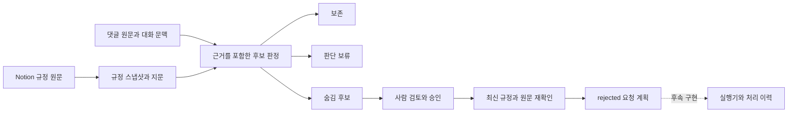

# YouTube 댓글 숨김 파이프라인 초안

2026-11-11: 사용자가 Notion 규정을 작성 중이며 아직 연결할 수 없다고 확인했다.
현재 결과는 **자연어 규정 입력·후보 판정 계약·사람 승인·요청 계획의 오프라인 프로토타입**이다.
실제 규정 연결, 모델 실행, 검토 UI, YouTube 쓰기, 운영 배포는 아직 구현·활성화하지 않았다.
기존 수집기의 GET 전용 전송기, 예약, 인증정보와 시트는 변경하지 않는다.



## 규정은 자연어로 받는다

사용자가 작성 중인 문서를 원본으로 지정한다. 규정마다 JSON이나 고정 ID를 요구하지 않는다.
`fetch_policy(fetch, page_id, channel_id)`는 연결된 Notion fetch 응답을 받아 본문과 수정 시각을
확인한다. 문서 전체를 읽지 못했거나 다른 페이지가 반환되면 판정을 시작하지 않는다.
페이지 ID·수정 시각·본문·적용 채널·채택 여부를 함께 해시한다.
규정이 바뀌면 버전 번호를 따로 고치지 않아도 기존 승인을 무효화할 수 있다.

규정에 예시·보관·하위 페이지가 섞여 있다면 적용 본문을 별도로 지정하는 작업이 먼저 필요하다.
현재 로더는 하위 페이지·DB·동기화 참조가 있는 문서를 임의로 따라가지 않고 중단한다.
실제 문서 구조를 확인한 뒤 적용 영역을 확정한다. `adopted`는 기본 false이며 문서의
‘자동 실행’ 같은 문장으로 변경되지 않는다. 임시 Notion 초안은 운영 규정으로 지정하지 않았다.

## 판정 결과와 사람 판단을 분리한다

`assess(policy, envelope, infer, model=...)`는 자연어 판정기를 주입받는다.
판정기는 보존 / 숨김 후보 / 판단 보류, 이유, 규정의 실제 인용문, 댓글의 실제 인용문,
보존 대상 해당 여부와 긴급 여부를 반환한다. 판정 프롬프트 버전과 모델 이름도 저장한다.
실제 모델 호출 어댑터는 규정 연결 후 선택·구현한다. 현재 예시는 고정된 합성 응답이며 AI 정확도를 검증한 결과가 아니다.

정상 비판·불만·질문·응원·이모지만으로 숨김 후보를 만들지 않도록 고정 지침을 둔다.
보존 사유와 위반 가능성이 충돌하거나, 인용문이 실제 원문·규정에 없으면 판단 보류로 돌린다.
부모 댓글이 누락된 답글도 판단 보류한다. 공식 계정 작성분은 자동 후보에서 제외한다.
모델 오류는 `classification_error`로 남긴다. 이런 검증은 의미 판단의 정확성을 보장하지 않으며
최종 검수자는 원문·문맥·규정의 실제 적용 여부를 확인해야 한다.

검토 화면은 댓글 원문·부모 문맥·링크·근거 규정·판정 사유·답글 동반 숨김 영향·검수자를 표시한다.
사람의 보존 판단과 검수 내용은 이후 자동 재판정과 별도 저장한다. 검토 UI와 영속 검토 큐는 후속 범위다.

## 승인된 원문에 대해서만 요청을 준비한다

`approve`는 채택된 규정의 숨김 후보만 대상으로 검수자와 검수 이유를 요구한다.
원댓글이면 답글까지 숨겨지는 영향에 대한 확인도 필요하다. 로컬 승인 레코드는
로그인된 검수자를 인증하는 기능이 아니며 운영 연결 시 서버 인증·권한 검사가 추가되어야 한다.

`prepare_rejection`은 승인된 후보의 지문, 최신 규정, 최신 원문·대화 문맥, 승인 만료를 확인한다.
승인 유효기간 24시간은 이 프로토타입의 임시값이며 운영 규정에서 확정할 항목이다.
규정·본문·문맥이 달라졌으면 재검수한다. 요청은 댓글 ID 1건, `moderationStatus=rejected`,
`banAuthor=false`로 한정하고 HTTP 요청 계획만 반환한다. 전송하지 않는다.

후속 실행기는 채널 소유 확인, 서버 인증된 승인, 변경 없는 스냅샷, 중복 실행 방지와 영속
outbox를 확인한 뒤 별도 실행한다. 요청 전 상태를 저장하고, HTTP 204는 ‘API 요청 수락’으로
기록한다. 응답 유실·실행 중단은 결과 미확인으로 남기며 자동 재전송하지 않는다.
원문·승인·실행 ID·오류를 보존하고 처리 기록을 수집 결과와 혼동하지 않는다.

## 실행과 검증

```sh
# 외부 연결·실제 데이터 접근 없이 합성 댓글 5건으로 전체 흐름 확인
python3 -m youtube_validation.moderation_demo

# 입력 누락·오인용·규정 변경·원문 변경·승인 누락·만료·후보 변조 검증
python3 -m unittest discover -s tests -p test_moderation.py -v
```

결과는 Git에서 제외된 `.local/youtube-moderation/demo.json`에 저장한다.
합성 댓글에 대한 보존 2건·숨김 후보 2건·판단 보류 1건과, 합성 승인 1건의 요청 계획을 확인한다.
실제 Notion 페이지·YouTube 댓글·OAuth·DB·시트를 읽거나 수정하지 않는다.

## 규정 작성 완료 후 연결할 항목

1. 규정 페이지와 적용 본문, 채택 상태를 확정한다.
2. 현재 Notion 인증 경로와 분리 권한을 확인하고 최신 규정을 읽는 어댑터를 연결한다.
3. 기존 YouTube DB는 읽기 전용으로 접근해 원문·부모·관측 가능한 답글과 링크를 구성한다.
4. 실제 판정기를 연결하고 사람이 검수한 표본으로 정상 비판 보존과 숨김 후보의 정확도를 평가한다.
5. 검토 큐·검수 UI·인증·처리 이력을 구현하고 승인된 댓글만 실행하는 전송기를 별도로 검증한다.

규정 초안에는 숨김 후보 기준뿐 아니라 보존할 의견, 애매할 때의 처리, 긴급 검토 기준,
사람 승인 권한을 함께 정하면 된다. 실제 규정이 완성되기 전에는 예시 기준을 운영 기준으로 적용하지 않는다.

## YouTube API 제약

[공식 setModerationStatus 문서](https://developers.google.com/youtube/data/reference/rest/v3/comments/setModerationStatus)는
채널 또는 영상 소유자 승인, `youtube.force-ssl` 범위, 요청당 최대 50개 ID와 50 quota units를 안내한다.
현재 문서에는 `rejected`를 `published`로 되돌릴 수 없다고 명시되어 있으므로 API 복구를 보장하지 않는다.
원댓글을 rejected로 처리하면 모든 답글도 함께 숨겨진다. 작성자 차단은 별도 기능이며 첫 범위에서 제외한다.
